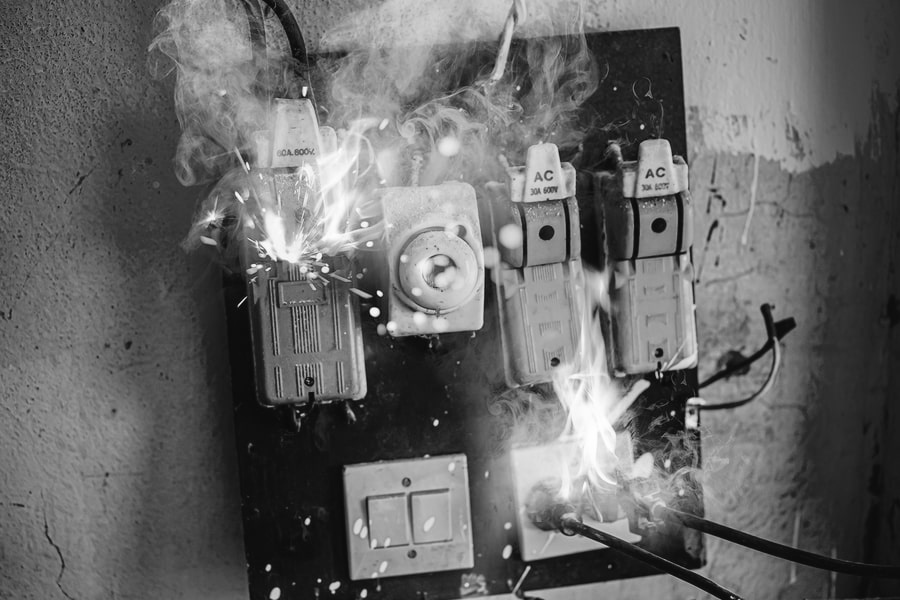
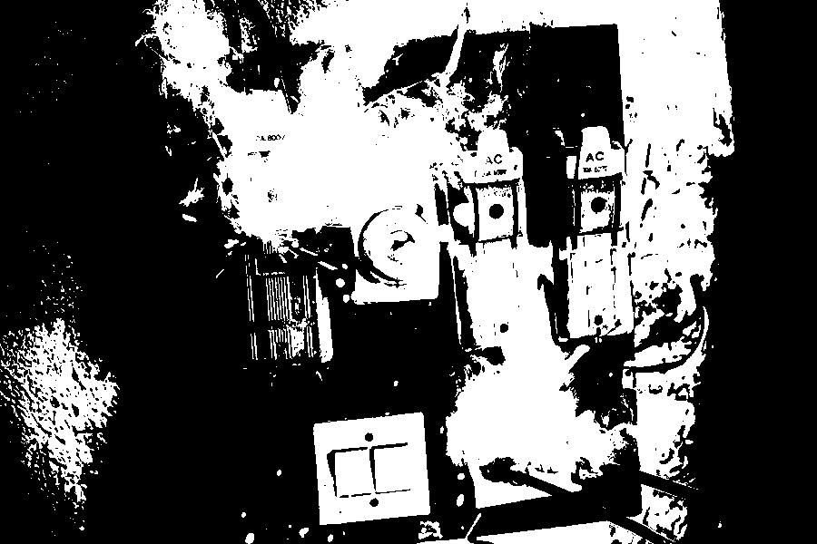

# OpenCV RGB to Grayscale Demo

Bu proje, OpenCV ile temel görüntü okuma ve renk dönüşümü işlemlerini gösteren
küçük bir Python uygulamasıdır. Bir giriş görselini doğrudan gri tonlamada okur,
BGR görüntüyü gri tonlamaya dönüştürür ve seçilen eşik değerine göre ikili
siyah-beyaz çıktı üretir.

## Gösterilen işlemler

- `cv2.IMREAD_GRAYSCALE` ile doğrudan gri tonlamada okuma
- `cv2.cvtColor` ile BGR, RGB ve gri tonlama dönüşümleri
- `cv2.threshold` ile ikili görüntü oluşturma
- Komut satırından giriş, çıktı klasörü ve eşik değeri seçme
- İsteğe bağlı OpenCV önizleme pencereleri

## Kurulum

```bash
python -m venv .venv
```

Windows:

```powershell
.venv\Scripts\Activate.ps1
python -m pip install -r requirements.txt
```

Linux ve macOS:

```bash
source .venv/bin/activate
python -m pip install -r requirements.txt
```

## Kullanım

Depodaki örnek görselle çalıştırmak için:

```bash
python image_processing_demo.py elektrik.jpeg
```

Eşik değerini ve çıktı klasörünü değiştirmek için:

```bash
python image_processing_demo.py elektrik.jpeg --threshold 150 --output-dir outputs
```

Sonuçları pencerelerde görüntülemek için komuta `--show` ekleyin. Üretilen
dosyalar varsayılan olarak `outputs/` klasörüne kaydedilir.

## Örnek sonuçlar

| Giriş | Gri tonlama | İkili görüntü |
| --- | --- | --- |
|  |  |  |

## Proje yapısı

- `image_processing_demo.py` - komut satırı uygulaması
- `requirements.txt` - Python bağımlılıkları
- `elektrik.jpeg` - örnek giriş görseli
- `elektrik2.jpeg` - `IMREAD_GRAYSCALE` örnek çıktısı
- `elektrik3.jpeg` - `cvtColor` örnek çıktısı
- `elektrik4.jpeg` - RGB dönüşüm örneği
- `elektrik5.jpeg` - ikili görüntü örneği
